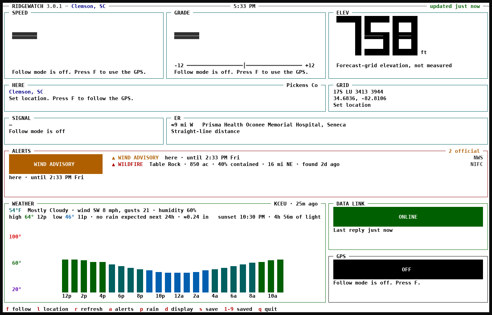

# Ridgewatch 3.0.1

A vehicle awareness dashboard for the terminal. It keeps watch while you drive: official
weather warnings, where you are, live GPS gauges, wildfires and road incidents.
Linux only, Python standard library only, nothing to install.



`SPEC.md` says what Ridgewatch is for and what it will never do. Read that first.

## Run it

```
./rw                        the dashboard (last place you used)
./rw --follow               follow the GPS
./rw --place "clemson sc"   pick a town or ZIP by name
./rw --coords "34.68, -82.84"
./rw --plain                one-shot text report
```

It needs Python 3.8+, a 256-color UTF-8 terminal and a window of at least 120×36.
On WSL, Windows Terminal works as is. Settings and saved data live in
`~/.config/ridgewatch` (or wherever `--home` points).

## The screen

Every tile has a fixed spot. A tile's border color is its warning light. Unknown values
show a dim dash and the reason.

| Tile | Shows | Turns amber or red when |
|---|---|---|
| SPEED | speed, heading, and the trip: miles, time moving and stopped, average and top speed | |
| GRADE | grade in big digits, the change over the last mile, a gauge from -12% to +12% | amber at 6%, red at 10% or on a long descent (500+ ft lost in 2 miles) |
| ELEV | elevation, the range over the last few miles, total climb and descent | amber on a 2D fix |
| HERE | distance and direction from the nearest town, county, next towns ahead | amber when the GPS is lost |
| GRID | map grid (MGRS / US National Grid), coordinates, accuracy | |
| SIGNAL | "online", or the way back to where the internet last answered | amber while offline |
| ER | the nearest emergency room, straight-line | amber when over 30 miles away |
| ALERTS | a master light (worst official warning, ALL CLEAR, or NOT UPDATING) and the list | the warning's own color |
| WEATHER | conditions, high and low, rain outlook, daylight, and a 24-hour graph (temperature on a fixed 20-100°F scale, or chance of rain when rain is likely) | amber title when the station is old and the forecast is standing in |
| DATA LINK | ONLINE, LIMITED, STALE, OFFLINE | |
| GPS | 3D FIX, 2D FIX, NO FIX, NO GPS, OFF | |

Sounds: two beeps for a new official warning; one beep when DATA LINK or GPS changes.

## Keys

`f` follow the GPS on/off · `l` pick a place · `a` alert details · `p` rain graph ·
`d` day / night / auto colors · `r` refresh · `s` save this place · `1`-`9` saved places ·
`q` quit. While you're moving, only `a p d r q` work.

## GPS

Plug in a USB GPS receiver and press `f`. The port is found automatically
(`/dev/ttyACM0` and friends). Your user needs to be in the `dialout` group:

```
sudo usermod -aG dialout $USER     # then log out and back in
```

For a fixed name that survives replugging, add a udev rule that creates `/dev/ttyGPS`;
Ridgewatch looks there first. To use a different port, set `"gps_port"` in
`~/.config/ridgewatch/config.json`.

On WSL the GPS has to be passed through from Windows with `usbipd`; without it,
pick a place with `l` and the GPS gauges show a dash.

## Data sources

| What | From | Needs |
|---|---|---|
| Warnings, forecast, conditions | National Weather Service (api.weather.gov) | nothing |
| Wildfires | National Interagency Fire Center | nothing |
| Road incidents | Georgia 511 and North Carolina DriveNC | a free developer key from each state, in `"keys_511": {"GA": "...", "NC": "..."}` |
| Towns, counties, hospitals | bundled files, read once at startup | nothing; they work offline |

## Code map

```
rw                       launcher
ridgewatch/cli.py        command line, crash log
ridgewatch/ui.py         the main loop, follow mode, alarms, keys
ridgewatch/cluster.py    the gauge-cluster screen and big digits
ridgewatch/panels.py     colors, the frame, weather and status boxes, detail screens
ridgewatch/views.py      turns saved data into what the screen shows
ridgewatch/nws.py        National Weather Service requests (background thread)
ridgewatch/feeds.py      wildfires and 511 roads (background thread)
ridgewatch/locate.py     the GPS reader (background thread, reconnects by itself)
ridgewatch/follow.py     when to refetch as you move
ridgewatch/places.py     offline towns and ZIP codes
ridgewatch/hospitals.py  offline emergency rooms
ridgewatch/geo.py sun.py theme.py settings.py plain.py   small helpers
tools/                   rebuild the bundled town and hospital files
tests/                   python3 -m unittest
```
